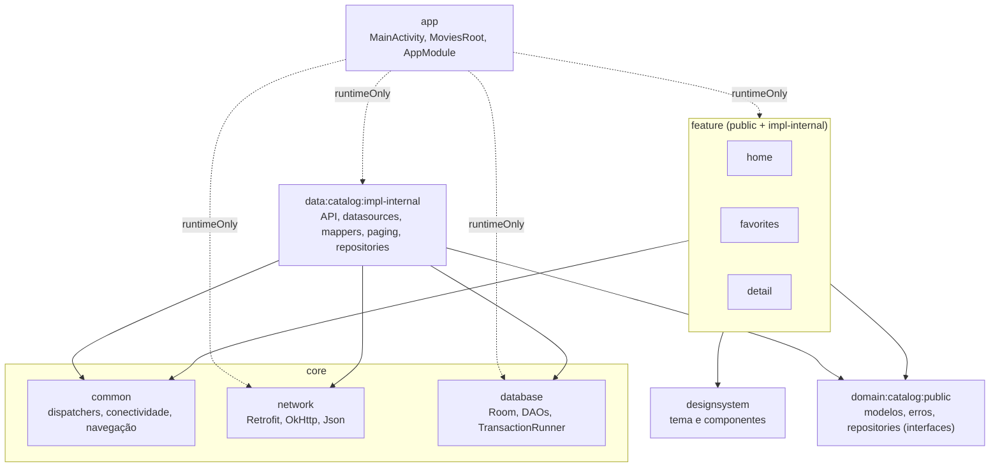

# Movies Challenge

App Android nativo que consome a API do [TMDB](https://www.themoviedb.org/) para explorar filmes e séries, com **busca**, **filtro por gênero**, **favoritos** e **detalhes com elenco**. É **offline-first**: tudo que já foi carregado fica no Room e continua disponível sem internet.

## O que o app faz

- **Home:** quatro carrosséis (filmes populares, filmes em cartaz, séries populares, séries mais bem avaliadas), busca com debounce de 300 ms e chips de gênero. "Ver todos" abre a grade paginada da categoria.
- **Favoritos:** lista local separada em Filmes e Séries, com chips de categoria, atualizada em tempo real em todas as telas.
- **Detalhe:** backdrop, nota, gêneros, sinopse e elenco (filme e série). Offline, mostra o que já foi salvo e avisa quando o elenco não está disponível.
- **Estados de UI:** skeleton no carregamento, erro com "Tentar novamente", estado vazio e banner offline.

### App em funcionamento

[▶ Assistir ao vídeo do app](docs/media/app.mp4)

## Como testar

### 1. Rodar o app

Requisitos: Android Studio recente (AGP 9.2), JDK 17+, emulador ou device com Android 12+ (minSdk 31).

1. Gere um **API Read Access Token** em TMDB → Settings → API.
2. Informe o token, sem commitá-lo (`local.properties` é ignorado pelo git):
    - `local.properties`: `TMDB_TOKEN=seu_read_access_token`
    - ou a variável de ambiente `TMDB_TOKEN`
3. `./gradlew :app:installDebug` (o token é lido na compilação; se mudar, recompile).

Sem token o app abre, mostra apenas o cache local e uma mensagem de erro acionável.

### 2. Roteiro de validação manual

1. Home: os quatro carrosséis aparecem (com skeleton durante o carregamento).
2. Digite na busca e selecione um gênero; limpe a busca para voltar às categorias.
3. "Ver todos" → role a grade até o fim (paginação).
4. Abra um título, veja sinopse e elenco, e favorite.
5. Aba Favoritos: o item aparece; desfavorite e confira a atualização.
6. Ative o modo avião: banner offline, conteúdo já visitado continua disponível.

### 3. Testes automatizados

```bash
./gradlew testDebugUnitTest   # todos os módulos (JVM, sem internet nem credencial)
./gradlew koverVerify         # gate: >= 85% de linhas por ViewModel
./gradlew koverXmlReport      # relatório em build/reports/kover/
./gradlew :app:assembleDebug  # build do APK
```

## Cobertura de testes

86 testes, todos na JVM, sem rede real: nenhum depende de token.

| Módulo | Tipo | Testes |
|---|---|---|
| `feature:home` | ViewModels (MockK), telas Compose (Robolectric), jornada integrada | 28 |
| `feature:detail` | ViewModel, tela Compose | 14 |
| `feature:favorites` | ViewModel, tela Compose | 9 |
| `data:catalog` | MockWebServer + Retrofit + serializers reais, Room em memória (Robolectric), mappers | 31 |
| `designsystem` | Componentes Compose | 2 |
| `core:common` | Observador de conectividade | 2 |

**Gate de cobertura:** o `koverVerify` exige no mínimo **85% de linhas em cada ViewModel** (regra por classe, não média). Resultado atual: `HomeViewModel`, `CatalogViewModel`, `FavoritesViewModel` e `DetailViewModel` com **100%**.

**Cobertura por módulo (Kover sem filtro, só testes unitários):** o gate acima cobre apenas as 4 ViewModels (100%). A cobertura do módulo inteiro é menor, porque inclui telas Compose, mappers, DI e código sem teste próprio.

| Módulo | Linhas | Branches | Métodos |
|---|---|---|---|
| `data:catalog:impl-internal` | 82% | 32% | 71% |
| `feature:detail:impl-internal` | 78% | 62% | 55% |
| `feature:home:impl-internal` | 68% | 56% | 54% |
| `feature:favorites:impl-internal` | 59% | 45% | 36% |
| `designsystem` | 54% | 23% | 56% |
| `core:common` | 52% | 50% | 29% |
| `core:database`, `core:network:impl-internal`, `domain:catalog:public`, `feature:*:public`, `app`, `core:testing` | 0% | 0% | 0% |

Os 0% não significam código sem uso: `core:database` e `core:network` são exercitados pelos testes do `data:catalog` (Room em memória e MockWebServer), mas o Kover só conta a cobertura no módulo onde o teste roda. `app` é validado pelo E2E instrumentado, fora desta medição. A camada de API (`TmdbApiService`, `ApiExecutor`, mappers) tem testes de contrato, mas o módulo `data:catalog` não chega a 100%.

**Padrão e reuso:** todos os testes seguem Given/When/Then (blocos comentados). Os helpers comuns ficam em `core:testing` (`MainDispatcherRule.unconfined()`, `ConnectivityObserverStub`, `mediaSummary`/`mediaDetail`, `collectInBackground`, `subscribeTo`); no `data:catalog`, `CatalogEnvironment` junta MockWebServer e Room em memória, e `TmdbPages.kt` gera os JSONs de página.

**E2E instrumentado:** `app/src/androidTest` (`MoviesJourneyE2ETest`, 2 testes) roda no emulador com o app real (Hilt, Room, Retrofit, Compose) contra um `TmdbServerStub` (MockWebServer), trocado via `@TestInstallIn`. Não precisa de token nem de internet. Cobre: Home lista o catálogo; favoritar → aba Favoritos → detalhe. Para rodar: suba um emulador e execute `./gradlew :app:connectedDebugAndroidTest`.

O que é coberto: sucesso, vazio, loading, refresh, cache com falha, erro sem cache, retry, debounce da busca, favoritar (e falha de escrita), falha de fluxo, argumentos inválidos, offline, e os contratos HTTP (path, query, autenticação, 401/403, 429, 5xx, JSON inválido).

## Arquitetura

Clean Architecture em módulos Gradle, com **MVI** na camada de apresentação. Cada módulo de negócio é dividido em `public` (contratos) e `impl-internal` (implementação com classes `internal`).



Setas tracejadas: o `app` só enxerga as implementações em tempo de execução, para o Hilt montar o grafo.

### Fluxo de dados (offline-first)

[▶ Assistir ao vídeo do offline-first em ação](docs/media/offline-first.mp4)

```
 UI (Compose)  --Action-->  ViewModel  --State/Effect-->  UI
                                |
                          Repository (interface, domain)
                                |
                       RepositoryImpl (data)
                       /                    \
          RemoteDataSource               LocalDataSource
          Retrofit + DTOs              DAOs (Room = fonte de verdade)
                \                            /
                 ----- RemoteMediator -------
          (rede alimenta o Room; a UI só observa o Room)
```

A UI nunca lê da rede: ela observa o Room. A rede só atualiza o banco, e o Paging 3 (`RemoteMediator`) cuida da paginação. Falha de rede preserva o conteúdo em cache e sinaliza o erro.

### Regras de dependência

- `impl-internal` nunca é acessado por outro módulo; `public` nunca depende de `impl-internal`.
- Features não conhecem `data`, `core:network` nem `core:database`: falam só com as interfaces do domain.
- O data não enxerga `CatalogDatabase`: recebe DAOs e `TransactionRunner`.
- O `designsystem` não depende de nenhum módulo de negócio: componentes recebem dados visuais e callbacks.

### Camada de apresentação (MVI)

Cada tela tem `UiState` (imutável), `UiAction` (selada) e `UiEffect` (eventos únicos, como navegação e snackbar), com `onAction` como única entrada. `StateFlow` + `collectAsStateWithLifecycle`; consulta e filtro sobrevivem a process death via `SavedStateHandle`. ViewModels chamam as interfaces de repository diretamente; não há use cases anêmicos.

## Injeção de dependência (Hilt)

- `@HiltAndroidApp` em `MoviesApp`; `@HiltViewModel` nos ViewModels; módulos em `SingletonComponent`.
- `AppModule` (app) provê `NetworkConfig` com a URL base e o token de `BuildConfig`.
- `NetworkModule` (core:network) provê `Json`, `OkHttpClient` (interceptor de autenticação) e `Retrofit`.
- `DatabaseModule` (core:database) provê o banco singleton e os DAOs.
- `CatalogDataModule` (data) usa `@Binds` para ligar datasources e repositories às interfaces do domain.
- `CommonModule` (core:common) provê `DispatcherProvider` e `ConnectivityObserver`, o que permite trocar dispatchers nos testes.
- **Navegação plugável:** cada feature contribui com um `FeatureEntry` via `@IntoSet`; o `MoviesRoot` monta o `NavHost` a partir do conjunto, sem conhecer as telas.

## Qualidade de código (ktlint + detekt)

Aplicados em todos os módulos pelo `build.gradle.kts` raiz.

```bash
./gradlew ktlintCheck detekt   # verifica estilo e análise estática
./gradlew ktlintFormat         # corrige a formatação automaticamente
```

- **ktlint** (`org.jlleitschuh.gradle.ktlint`): formatação, configurada em `.editorconfig` (linha máxima de 140).
- **detekt** + [compose-rules](https://github.com/mrmans0n/compose-rules): code smells e boas práticas de Compose, configurado em `config/detekt/detekt.yml`.

## Decisões técnicas

| Tema | Decisão |
|---|---|
| Identidade | `MediaKey(type, id)`: filme e série com o mesmo id não colidem |
| Erros | `CatalogException` seleciona a mensagem (rede, token, 401/403, 429, 5xx, contrato); `CancellationException` nunca vira erro de UI |
| Threads | `DispatcherProvider` injetado; I/O em `Dispatchers.IO`; sem `GlobalScope` |
| Busca | Debounce de 300 ms; offline pesquisa só o conteúdo já salvo |
| Cache | Listagens com TTL de 30 min; atualizar uma categoria não apaga as outras nem favoritos/detalhes |
| Persistência | Room com schema exportado; módulo próprio `core:database` |
| Build | Version catalog + convention plugins (`build-logic`), AGP 9, Kotlin 2.2 |

Stack: Kotlin, Jetpack Compose, Material 3, Hilt, Retrofit + kotlinx.serialization, Room, Paging 3, Coil 3, Kover, MockK, Robolectric.

## Limitações conhecidas

- O app ainda não foi validado em device/emulador com o TMDB real (os testes usam MockWebServer).
- Conteúdo nunca aberto online não existe offline; o elenco só aparece offline após abrir o título online.
- Sem estratégia de migração do Room (schema na versão 1).
- Mensagens de erro do domain (`toUserMessage()`) ainda são texto fixo.
- O token embarcado no APK não é um segredo inviolável.
- O filtro de gênero local com paginação pode buscar várias páginas até achar resultados.
- Pontos de melhoria por classe, com trade-offs: [docs/CLASSES.md](docs/CLASSES.md).

Dados fornecidos por TMDB. Este produto usa a API do TMDB, mas não é endossado nem certificado pelo TMDB.
